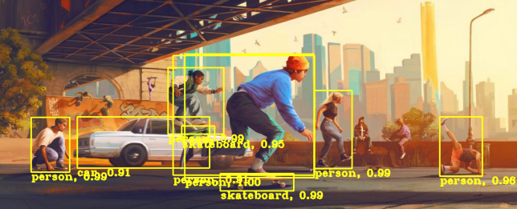

# opencv-demos-py

A collection of OpenCV demos and utilities built during a month-long course.
This is not production-ready code - it is beginner level learning documentation
that may help others starting out with OpenCV.


## Overview
This project contains:
- Demo notebooks for common computer vision tasks
- A utility package (cv_utils) for reusable image and video processing components
- Pipeline implementations for object detection workflows

## Project Structure
```
opencv-demos-py/
  demos/
    detection_pipelines/            # Advanced detection notebooks (YOLO, face, lane, mask)
    edges_shapes.ipynb              # Edge detection on shapes
    edges_circuitboard.ipynb        # creating contours of circuitboard components
    filtering.ipynb                 # Highpass / lowpass filters
    histogram_img_enhancer.ipynb    # Color channel balancing

  src/
    cv_utils/             # Reusable utility package
      detection/            # Detector implementations
      drawing/              # Shape drawing helpers
      processing/           # Filters, edges, masking, histogram
      shapes/               # Shape generators
      video/                # Video processing utilities
      visualisation.py      # Visualization helpers
```

## Installation
### clone and install
Clone the repository:

```
git clone https://github.com/Dyretna/opencv-demos-py.git
cd opencv-demos-py
```

Install dependencies:

```
pip install -e .
```

### Set Path to Data
Data files are too large to include in the repository. Set your data directory in a .env file:

```
DATA_DIR=/path/to/your/openCV/data/folders
```

The demo notebooks will automatically load this path via python-dotenv.


### Note on Requirements
Recommended library versions (newer versions may cause compatibility issues):

- OpenCV: 4.8.0
- NumPy: 1.24.0
- Python: 3.10+

If you install through the .toml -file (as sepcified above) You should be fine :)

Enjoy :)
